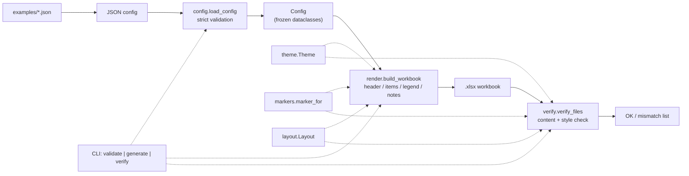
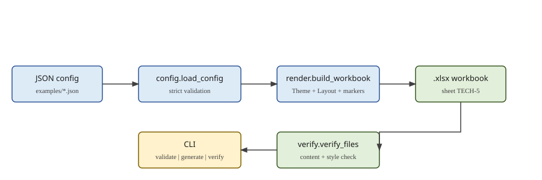

# tech5-work-schedule

Generate a World Bank **TECH-5 — Work Schedule and Planning for Deliverables**
workbook from a structured JSON config: one config in, one formatted Excel
bar chart out.

<!-- Hero screenshot — un-comment once docs/assets/sample-schedule.png exists (see Visual assets note at the end of this file).

-->

## Description

TECH-5 is one of the standard forms in Section 3 (Technical Proposal) of the
World Bank's standard procurement documents. It lays out deliverables with
the breakdown of activities required to produce them, plus other benchmarks
such as client approvals, across the assignment's time units, with the
duration of each activity shown as a bar chart.

`tech5-work-schedule` automates that form. You write a JSON config describing
phases, activities, and deliverables and their active periods, and the tool
produces a formatted `.xlsx` workbook: a title and duration header, the
period grid with █ for phases, X for activities, and a red ♦ for
deliverables and milestones, a Total column, a legend, and the form's three
guidance notes — ready to check, print, and attach to a technical proposal.

This tool is unaffiliated with the World Bank. It does not validate your
schedule against any procurement rules; it renders the schedule you give it.

**What this tool is not:**

- Not a schedule editor or planner. There is no UI and no date arithmetic:
  periods are ordinals (1, 2, 3, …) in whatever time unit you name, and
  there is no start date in the schema.
- Not a calculator. The Total column holds author-supplied display text
  (for example `"2 Weeks"` or `"Week 10"`), not a sum computed from the
  active periods. If a total is wrong, the tool renders it faithfully —
  check your totals before generating.
- Not a validator of proposal content. Config validation checks structure
  (keys, types, duplicate ids, periods in range); it cannot tell whether
  your schedule itself is realistic.

The bundled examples hold fictional data only. Formerly `mp-tech5`; renamed
for publication. See [CHANGELOG.md](CHANGELOG.md).

## Prerequisites

- **Python 3.11 or newer.** Check with `python --version` (Windows:
  `py --version`). Python 3.12 and 3.13 are also tested in CI.
- **pip**, which ships with Python.
- **git**, to clone the repository.
- A spreadsheet app to *view* the output — Microsoft Excel or LibreOffice.
  The tool itself needs no spreadsheet app; it writes `.xlsx` files
  directly with openpyxl.
- No other runtime dependencies. The only runtime library is
  `openpyxl >= 3.1`, installed automatically with the package.

## Installation

There is currently no PyPI package for this project, so installation is
from a checkout. That is deliberate and stated here plainly — do not look
for it on PyPI yet.

```bash
git clone https://github.com/enonymous1/tech5-work-schedule.git
cd tech5-work-schedule
```

Create and activate a virtual environment (recommended, keeps the install
isolated from your system Python):

```bash
# macOS / Linux
python3 -m venv .venv
source .venv/bin/activate
```

```powershell
# Windows PowerShell
py -m venv .venv
.\.venv\Scripts\Activate.ps1
```

Then install:

```bash
pip install .
```

Confirm the install:

```bash
tech5-work-schedule --version
# tech5-work-schedule 2.1.0
```

<!-- CLI demo GIF — un-comment once docs/assets/cli-demo.gif exists.

-->

If you only want to try it once without installing, see
[Local Development](#local-development) for running from source with
`PYTHONPATH`.

## Usage

Three commands cover the whole workflow. Run them in this order for a new
config: validate it, generate the workbook, then verify the workbook
against the config.

```bash
# 1. Validate a config without generating anything
tech5-work-schedule validate --config examples/sample_tech5.json
# Project: National Interoperability Framework - Example Schedule
# Duration: 9 Months
# RFP Reference: {Insert RFP reference}
# Items: 23
#   Activity: 15
#   Deliverable: 4
#   Phase: 4
# Config is valid.

# 2. Generate the workbook
tech5-work-schedule generate --config examples/sample_tech5.json --output schedule.xlsx
# Wrote: schedule.xlsx

# 3. Verify the generated workbook against its config, cell by cell
tech5-work-schedule verify --config examples/sample_tech5.json --workbook schedule.xlsx
# OK: schedule.xlsx matches examples/sample_tech5.json
```

With no `--output`, `generate` writes to `output/` under the current
directory, named `TECH5_<project>_<timestamp>.xlsx` (for example,
`output/TECH5_National_Interoperability_Framework_Example_Schedule_20261027_070027.xlsx`).
The timestamp is local time to the second; if you generate twice in the
same second with the same project name, the second file gets a `-2`,
`-3`, ... suffix instead of overwriting the first. An explicit
`--output` path is still overwritten if it already exists.

### Exit codes

| Code | Meaning |
|------|---------|
| 0 | Success (`validate` passed, `generate` wrote the file, `verify` matched). |
| 1 | `verify` found mismatches. Every mismatch is listed on stderr. |
| 2 | Usage error, invalid config, or I/O error (unreadable config, unwritable output). Config errors name the JSON path, for example `schedule_items[3].active_periods[1]: period 0 is outside 1..9`. |

Note: `argparse` usage errors (for example a missing required flag) also
exit 2; that is argparse's convention, not a separate code.

### Output layout

The generated workbook has a single sheet, `TECH-5`:

| Rows | Contents |
|------|----------|
| 1 | Project name (bold, merged across the table). |
| 2 | RFP reference (if given) and duration, for example `RFP Reference: {Insert RFP reference}  \|  Duration: 9 Months`. With no RFP reference, row 2 is the duration only. |
| 3–4 | Two-row header: `N°`, `Activity / Deliverable`, the time-unit label merged across the period columns, period numbers, and `Total`. |
| 5… | One row per schedule item, in config order. |
| (blank) | One blank row. |
| Legend | `Legend:` followed by █ Phase Duration, X Activity Duration, ♦ Deliverable / Benchmark / Approval. |
| Notes | The three World Bank guidance notes, merged across the table width. |

Styling: Gill Sans 10 (the workbook *specifies* Gill Sans; viewers without
that font substitute their own), light-blue header, light-blue phase rows,
soft-green deliverable rows, red bold ♦ for deliverables and milestones.
Panes freeze below the header and left of the period columns, printing is
landscape fit-to-width on A4, and rows 1–4 repeat on every printed page.

`verify` checks content — titles, ids, descriptions, markers, Total
texts, legend, and notes — plus key styling against the default theme:
header/phase/deliverable fills, milestone marker colour and boldness,
font name, freeze panes, and print setup. A workbook with correct
values but stripped formatting now fails verification. It does not
check every cell's font or border, so eyeball formatting in a
spreadsheet app before sending a proposal out.

## Config format

```json
{
  "project_meta": {
    "project_name": "National Interoperability Framework - Example Schedule",
    "rfp_reference": "{Insert RFP reference}",
    "time_unit_label": "Months",
    "total_duration": 9
  },
  "schedule_items": [
    {
      "id": "A-1",
      "description": "PHASE 1: INCEPTION & MOBILIZATION",
      "type": "Phase",
      "active_periods": [1],
      "total_text": "2 Weeks"
    },
    {
      "id": "D-1",
      "description": "DELIVERABLE 1: INCEPTION REPORT (Due Week 2)",
      "type": "Deliverable",
      "active_periods": [1],
      "is_milestone": true,
      "total_text": "Week 2"
    }
  ]
}
```

### `project_meta`

| Field | Required | Notes |
|-------|----------|-------|
| `project_name` | Yes | Non-empty string. Rendered in row 1 and used (slugified) in the default output filename. |
| `total_duration` | Yes | Integer, at least 1. The number of time units in the schedule; every period must fall in `1..total_duration`. |
| `time_unit_label` | No, default `"Months"` | Non-empty string. Used as the merged header label and in the duration subtitle. It is a label only — no date conversion is performed. |
| `rfp_reference` | No | Non-empty string if present. Rendered in row 2; display-only, never looked up. Replace with a placeholder (as in the sample) for any public or shared example. |

### `schedule_items`

A non-empty list. Each item:

| Field | Required | Notes |
|-------|----------|-------|
| `id` | Yes | Non-empty string, unique across items. Rendered in column A. |
| `description` | Yes | Non-empty string. Rendered in column B, wrapping onto extra lines (with a taller row) when it exceeds the column width. |
| `type` | Yes | One of `Phase`, `Activity`, `Deliverable`, `Sub-Activity`. |
| `active_periods` | Yes | Non-empty list of period numbers, or `"start-end"` range strings such as `"2-3"`. Every period must be in `1..total_duration`; out-of-range, reversed, malformed, boolean, and float periods are errors. Overlapping entries (for example `[1, "1-2"]`) are deduplicated, so a cell holds at most one marker. |
| `is_milestone` | No, default `false` | Boolean. Upgrades an Activity or Sub-Activity row's markers to ♦. Deliverables always render as ♦ regardless of this flag, because the legend defines ♦ as "Deliverable / Benchmark / Approval". |
| `total_text` | No | Non-empty string if present. Rendered verbatim in the Total column. Author-supplied display text, not a computed sum. |

Validation is strict and fail-loud: unknown keys, missing keys, duplicate
ids, invalid types, and out-of-range periods are errors naming the JSON
path, never silently skipped. A config written in the original project's
older schema (`project_metadata` / `phases` / `months`) is rejected with
guidance toward this schema — that older schema was never read by the
original generator, so converting it by hand to this format is required.

## Examples

- `examples/sample_tech5.json` — a 23-item, 9-month fictional schedule
  (phases, activities, deliverables, workshops, total texts). Start here.
- `examples/minimal_tech5.json` — a 5-item, 4-month config exercising
  range periods, a Sub-Activity, and a Deliverable with no `is_milestone`
  flag.

The original project's Kosovo configs and rough-draft workbook were real
proposal material and are not shipped here. The sample keeps their
structure and durations with fictional, generalized wording, and the RFP
reference replaced by a placeholder.

## Local Development

### Module map

| Module | Responsibility |
|--------|---------------|
| Module | Responsibility |
|--------|---------------|
| `src/tech5_work_schedule/config.py` | JSON loading and strict validation; frozen `ProjectMeta`, `ScheduleItem`, `Config` dataclasses and the `ItemType` enum. The only module that knows the config schema. |
| `src/tech5_work_schedule/markers.py` | The marker rule (`marker_for`): the single source of truth for █ / X / ♦. |
| `src/tech5_work_schedule/layout.py` | Frozen `Layout`: Total column, data rows, freeze panes, print titles. |
| `src/tech5_work_schedule/theme.py` | Frozen `Theme`: colours, fonts, widths (`DEFAULT_THEME` reproduces the v2.0.0 look). |
| `src/tech5_work_schedule/render.py` | Workbook rendering (`build_workbook`): header, items, legend, notes, sizing, print setup. |
| `src/tech5_work_schedule/io.py` | File output (`generate`, `slugify`, collision-numbered default paths). |
| `src/tech5_work_schedule/generator.py` | Backwards-compatible re-exports from `render` and `io` only. |
| `src/tech5_work_schedule/verify.py` | Verification (`verify_workbook`, `verify_files`): content plus key styling against a theme. |
| `src/tech5_work_schedule/cli.py` | Argument parsing and the three subcommands; exit-code contract (see Usage). |
| `src/tech5_work_schedule/errors.py` | `ConfigError`, the single error type for config problems. |
| `src/tech5_work_schedule/__init__.py`, `__main__.py` | Public API exports, package version, and `python -m tech5_work_schedule` entry point. |





### Set up for development

```bash
git clone https://github.com/enonymous1/tech5-work-schedule.git
cd tech5-work-schedule
python3 -m venv .venv
source .venv/bin/activate   # Windows PowerShell: .\.venv\Scripts\Activate.ps1
pip install -e ".[dev]"
```

Run the CLI from source without installing, from the repo root:

```bash
PYTHONPATH=src python -m tech5_work_schedule validate --config examples/sample_tech5.json
```

### Checks

```bash
ruff check src tests
ruff format --check src tests
mypy src
pytest -q
```

The suite is 48 tests. Its two load-bearing tests are the golden marker
grid (every cell of the 23-item sample asserted against its config) and
the CLI round trip (validate → generate → verify). Run the full suite
before any release; ruff, ruff format, mypy, and pytest are all gated in
CI (Python 3.11–3.13 on Ubuntu, plus Python 3.12 on Windows), along with
a build check (`python -m build`, `twine check`).

### Test philosophy

- Prefer golden-output tests (the marker grid) over unit tests of
  internals: the workbook *is* the product, so assert its cells.
- Prefer fail-loud validation tests (bad periods, duplicate ids, unknown
  keys) over happy-path-only coverage: the validator is the feature users
  rely on when a config is wrong.
- Do not add screenshot-comparison tests. Spreadsheet rendering varies by
  viewer and font availability; the suite asserts values and layout
  metadata (freeze panes, print titles) and leaves visual checks to a
  human opening the file.

## Deployment

For a command-line tool, "deployment" means publishing a release, not
running a service. There is no hosted component, no database, and no
server to deploy.

### GitHub release (the deployment path)

1. Run the full check suite and a generate/verify round trip on the
   sample config.
2. Update `CHANGELOG.md` with the release notes and bump the version in
   both places it is declared: `pyproject.toml` and
   `src/tech5_work_schedule/__init__.py`. They are kept in sync by hand
   on release — check both, or the installed package will report a
   different version from the published metadata.
3. Commit, tag, and push:

```bash
git tag v2.1.0
git push origin main
git push origin v2.1.0
```

4. Create a GitHub Release from the tag, with the CHANGELOG entry as the
   release notes. The first push also starts CI (ruff, ruff format,
   mypy, pytest on Python 3.11–3.13); confirm it is green before
   announcing the release.
5. Set the repo description and topics in the repo's About section (or
   with `gh repo edit`); the description and topics are GitHub metadata,
   not part of the git history.

### What is not deployed

- **No PyPI package (yet).** Until someone asks for `pip install
  tech5-work-schedule`, installation stays "clone and install from
  source" as documented above. Adding PyPI later means a build check
  (`python -m build`, `twine check`) in CI and a publish step on tag —
  do not add either until the package name is reserved.
- **No GitHub Pages site.** The project has no web UI, so Pages would
  host only this README. Skip it.
- **No hosted demo.** Generating a workbook requires a local config
  file; a hosted demo would need file uploads and a sandbox, which is a
  different product with a security story this tool does not have.

## Troubleshooting

| Symptom | Cause and fix |
|---------|---------------|
| `config root: unsupported schema using 'project_metadata'/'phases'` | Config is in the original project's older schema. Rewrite it to `project_meta` / `schedule_items` as in Config format above. |
| `period X is outside 1..N` | An `active_period` exceeds `total_duration` (or is 0/negative). Fix the period or raise `total_duration`. |
| `unknown key(s): ...` | A typo'd or removed field. Validation is strict by design — remove or rename the key. |
| `command not found: tech5-work-schedule` | The install step was skipped, or the venv is not activated. Re-run `pip install .` with the venv active, or use `PYTHONPATH=src python -m tech5_work_schedule` from the repo root. |
| `pip install -e .` fails outside a checkout | Editable installs require the repo directory (they link to its source). Clone first, `cd` into it, then install. For a one-off try, `pip install .` from the checkout works the same way. |
| Generated workbook looks wrong in a viewer | Check the file with `verify` first: if it matches, the values are right and the issue is viewer rendering (notably font substitution for Gill Sans). Open in Excel if you have it; LibreOffice substitutes fonts differently. |
| `verify` reports mismatches on a hand-edited workbook | Expected: `verify` compares against the config, so any hand edit after generation is a mismatch by design. Regenerate from the config instead of editing the workbook. |

## Contributing

Issues and pull requests are welcome. Please:

- Add or update tests for any behaviour change, especially validation
  rules and rendered cells (see Test philosophy above).
- Run `ruff check`, `ruff format --check`, `mypy src`, and `pytest -q`
  before opening a pull request.
- Keep the runtime dependency list at one (openpyxl) unless a new
  dependency is clearly justified in the pull request description.
- Do not include real proposal data, client names, or RFP references in
  examples or tests — examples are fictional by policy.

## License

MIT. See [LICENSE](LICENSE).

<!--
Visual assets note (for the maintainer, not part of the published README
once the assets exist — delete this comment block when all links above
are un-commented):
- docs/assets/sample-schedule.png — hero screenshot of the generated
  sample workbook open in Excel/LibreOffice, rows 1–32, columns A–L.
  Placed after Description. Capture from a real generated file only.
- docs/assets/architecture.svg — rendered Mermaid architecture diagram.
  Placed in Local Development after the module map.
- docs/assets/cli-demo.gif — ≤15s terminal recording of validate →
  generate → verify on the sample config. Placed in Installation after
  the --version check.
- docs/assets/print-preview.png (optional) — print preview of the sample.
  Placed in the Output layout subsection.
-->
